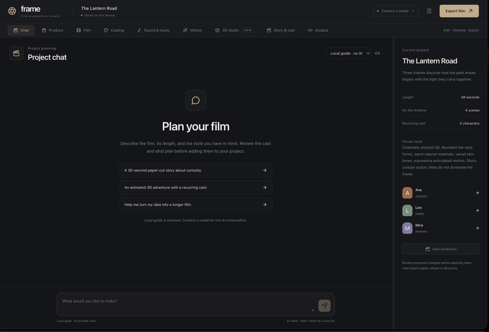
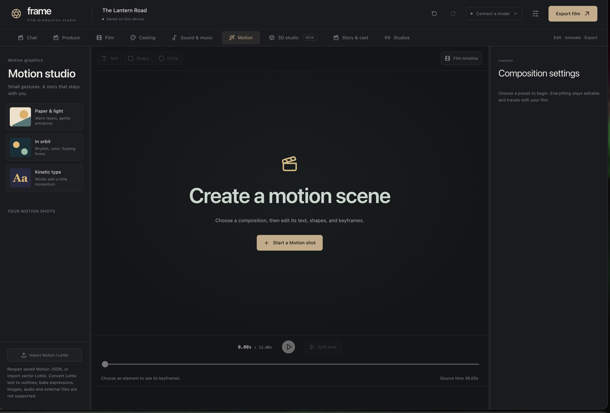

# Frame — Short Films AI Harness

**Bring a story to life, one editable shot at a time.** Frame is an open-source film studio where you can combine animated 3D scenes, code, generated footage, music, and narration on one timeline. Sketch an idea in Chat, build a cast, direct a scene, and keep shaping the result by hand or with your own connected models.

Frame runs on the web and as a macOS app. It is built with TypeScript, React, Three.js, Rust/WebAssembly, and Tauri, with a PulseForge-powered Sound Studio.

**Frame is a work in progress.** Some integrations require separately installed tools or provider accounts, and generated results need review. We welcome developers, artists, filmmakers, testers, and curious experimenters: open an issue, suggest an improvement, contribute a fix, or take the project in a new direction.

Frame's original project code is available under the [MIT License](LICENSE): use, modify, share, fork, or rewrite it, including for commercial projects, while retaining the required copyright and license notice. Bundled third-party components, fonts, models, and services have their own terms; see [third-party notices](docs/THIRD-PARTY-NOTICES.md) and the [included references and licenses](#included-references-and-licenses).

**[Open the hosted studio](https://frame-short-films.vercel.app)** · **[Report an issue or share an idea](https://github.com/CartyChris/frame-short-films/issues)**

No account is needed to edit, play the included films, compose procedural sound, or export HTML. Connect your own model account when you want AI generation. Provider credits are billed by that provider.

## Frame in action

These screenshots show an earlier Frame build; the interface continues to evolve.

### Plan a film in Chat

Describe an idea and develop its story, cast, and shot plan in the studio.



### Create in Motion Studio

Choose a composition and edit motion elements alongside the rest of your film.



## New in Frame 

Chat supports attached files and an editable shot outline. Production tools connect to separately installed ComfyUI and Freefield servers, with scoped Comfy Cloud and Higgsfield Cloud adapters. [Frame 7 studio guide](docs/frame-7-studio.md) describes the exact support and limitations. Jolt rigid-body baking, seeded Three.quarks effects, GPU path tracing and optically centered playback controls extend the existing Anime.js/Lottie, cinematic 3D, caption/beat/cut and ComfyUI workflows. All use the existing saved film and recovery system. [Integration guide and boundaries](docs/MOTION-INTEGRATIONS.md).

## Start with Frame

- **Chat:** develop your idea with a connected model, answer useful questions, and save a proposed story/cast/shot plan. The local guide can create a basic outline without an API; it is labelled as a guide rather than AI inference.
- **Produce:** describe the film, choose its duration and animation approach, then choose **Produce the movie**. This explicitly starts an automatic queue: the agent plans the story, designs reusable characters and models, generates each shot, directs an editable musical arrangement, and optionally creates local narration. Completed scenes are applied to the timeline; previous scene versions and all received drafts are retained. You can pause, change the connected model, and resume.
- **Casting:** create people, robots, and creatures with editable palettes, paper/toon/pixel/ink styles, sketches, reference images, and procedural 3D parts. Share one canonical model across shots. Open the shape workshop to change geometry, parents, pivots, and animation joints; export a model as GLB or replace it with an imported model.
- **Sound & music:** compose an editable score, place steps and piano-roll notes, change instruments, and mix effects. Render a preview, then add the WAV to the film. Voice combines your microphone or uploaded takes, optional free local neural speech, and an explicitly selected paid voice provider. Film mix edits start, trim, fades, looping, volume, and mute on the same audio layers used in exports.

**Automatic production applies finished steps.** The separate scene Director and Story & cast revision queues still let you inspect and explicitly use each draft. Production settings include a text-request cap, media provider/model choices, and optional paid character portraits. A video job is submitted only for a planned video shot. Keep Frame open while production runs; it is not a background cloud rendering service.

For a long film, use scene-by-scene production. Reuse characters and locations, keep the story bible current, and retain portable backups. Planning a two-hour timeline does not mean one unbounded model response or one uninterrupted server request.

## Animation, story and interchange

- **3D studio:** explore a real Three.js scene while it plays. Select objects in the viewport or outliner, move/rotate/scale them, pose keyframes, edit paths and imported animation clips, and direct a camera with keyframes. Resize the side panels. On phones, switch between Assets, 3D view, and Edit.
- **A reusable cast:** three animated built-in characters and scenery are ready to use. Import your own models, replace one object or a model across the film, and change shared appearances. The same underlying model is used in every shot that references it. Open **3D studio → Explore the animated example** for *The Lantern Road*.
- **Story & cast:** maintain character looks, voices, locations, fixed facts, and story state. Each generation receives selected canon, previous scene summaries, and only previously established facts. Optional reference images are sent to supported image/video models; no identity guarantee is made for generative video.
- **Feature-length planning:** set a 30-minute or two-hour target; ask for a shot plan or paste one. Validate, review, and approve the plan, then generate and review scenes individually. Revise one scene or queue revisions across a whole film. Unaccepted drafts never replace accepted scenes or establish future story facts.
- **Clip editing:** split or trim code, video, and 3D shots while retaining the source clock. Reorder the timeline, edit one shot with AI, restore a prior complete scene, or continue a partial HTML/3D/plan response using another provider.
- **Open studios:** animated GLB import/export, Blender exchange with the included add-on, guided Tripo CLI receipts and model imports, local MCP discovery and explicitly reviewed calls, and a room-planning kit. See [studio integration details](integrations/README.md).

Generated footage, imported images/video, 3D scenes, code animation, narration, and sound share one film timeline. Image/video layers can overlay the 3D base. Single-file HTML embeds the shared 3D runtime once, the referenced models, and media. The offline renderer makes MP4 from the same timeline.

## Direct a continuous 3D story

1. Open the 3D example or add a new 3D shot. Play it, explore with drag/zoom, and select a character. Choose Move, Rotate, or Scale and drag its handle; the numeric controls provide precision.
2. Save a pose keyframe, move the playhead, and change the pose. Adjust performance, speed, path points, or an imported animation clip. Camera **Use this view** replaces the film camera; **Keyframe view** records a moving shot.
3. Use the same shared model in following shots. For continuous action through a cut, split an existing shot: the second clip keeps the original animation offset. In **Shots**, switch shots without duplicating the cast library.
4. In **Story & cast**, assign characters and places to each scene. Record what changes after the scene. These facts and previous scenes feed the next generation. Changing a model's appearance across the film updates its linked canonical appearance; review any free-text fixed facts you wrote about the old costume.
5. For image/video conditioning, link still images to cast/locations, then select them in **This scene**. **3D studio → Clip & export → Save reference frame** creates a clean film-camera still in Media. **Film → Generate → Character & scenery references** chooses reference or first/last-frame mode. Select a model that supports that input; errors do not silently retry without references.
6. **Studios → Blender** exports real meshes, supported animated transforms, and camera samples. Import the returned exchange as a new animated model scene. Keep the `.blend` master for detailed editing.

The procedural characters have articulated motion and a small style library; this is not a full skeletal rigging or physics simulator. For custom rigging, facial performance, simulations, or advanced materials, use Blender and import baked GLB or rendered footage. CAD solids/STEP/IGES must first be tessellated to GLB, OBJ, or STL. The format matrix in Studios explains these boundaries.

## Your first film

1. Play the supplied 30-second project, choose a template, or add the supplied Western civilization reference.
2. Select a scene in the timeline. Change its length, title, transitions, and layers in **Scene**. Drag scenes to reorder them; drag the panel edges to resize your workspace.
3. Choose **Connect a model**, load its live catalog, and add a connection. In **Director**, describe the scene. Review the generated source before choosing **Use draft**.
4. Use **Media** to upload images, video, or sound. Add them to the timeline and adjust position, scale, opacity, blend mode, trim, and timing. **Generate** creates images or video through supported providers.
5. Open **Sound & music** for the sequencer, piano roll, narration, procedural effects, and final film mix. The Film inspector also retains quick audio tools.
6. Choose **Export film → Single-file HTML** to share the film. Choose **Complete project** to retain an editable backup, all library media, previous versions, and unfinished drafts.

The four workspace themes include a quiet editing room, a warm paper studio, and two animated Three.js environments. Film templates include paper cut-out, cosmic, kinetic typography, aurora, blueprint, and a blank canvas. Resolution, aspect ratio, frame rate, color, scene duration, and media settings are editable.

## What is included

| Capability | Hosted web / PWA | macOS |
| --- | --- | --- |
| Chat, automatic production, Casting, Sound Studio, 3D, story bible and Blender exchange | Yes | Same interface |
| Procedural music and effects | Local, no API required | Local, no API required |
| Local Kokoro narration | First model download, then on-device inference | Same browser/WASM engine |
| Film editor, layers, templates, code editor, Rust timeline | Yes | Same interface |
| API text models, images, video, speech | Your API keys | Your API keys via configured hosted API |
| Codex / Claude Code subscription sessions | Companion on the same Mac, subject to browser loopback access | Bundled companion, installed signed-in CLI |
| Z.AI Coding Plan | Supported local Claude Code route | Supported local Claude Code route |
| Received-code recovery and version history | IndexedDB on this device | IndexedDB plus native disk backups |
| Portable HTML, editable project archives | Browser downloads | Frame’s app-data exports folder |
| Microphone narration | Browser permission required | macOS permission required |
| Full-composition video | Desktop browser tab recording | Included offline MP4 command-line renderer; browser capture support varies |
| Offline editing / playback | Install PWA once online | Bundled app |
| Automatic cloud synchronization | Not included; move project backups between devices | Not included; move project backups between devices |

## Music and voice

The score engine reuses inspected PulseForge composition, synthesis and mixer modules. A connected agent can write a validated musical specification; the local composer turns that into editable notes, patterns and routing. Manual composition uses seeded musical rules without a model or API. The instruments are procedural approximations of piano, guitar, strings, brass and other sounds; no recorded instrument library is bundled.

Render one cue or selected pattern at a time, up to **120 seconds per WAV**, then loop or stitch cues across a film of any length. Editable arrangements support up to 30 minutes within the documented source bounds. A seamless-loop render retains the musical duration; regular renders include a short effect tail. Parameter changes are heard on the next preview render. The browser's native offline renderer cannot be interrupted mid-buffer, but cancelling leaves the editable source intact.

Save the score as `.framesound.json` or export a native PulseForge `.pfproj`. Import supports synth-only PulseForge projects: recorded/sample assets, unsupported meters and routing are rejected with guidance to export those parts as WAV. It does not silently drop recordings. Upload WAV/MP3 and other supported audio separately into Film mix. See [sound interfaces, import limits and source provenance](src/lib/sound/README.md).

**Voice → Local · free** runs Kokoro on your device. Its first explicit generation downloads a 92.4 MB quantized voice model plus voice/runtime files; later sessions can reuse the browser-managed cache. No API key or per-use charge is involved. It needs a current browser with workers and WebAssembly, enough memory, and initial network access. Cache eviction can require another download. The model is not bundled into exported films: the resulting WAV is embedded instead. Each completed phrase is checkpointed; interrupted narration offers the completed audio for saving. Automatic production creates narration per planned scene and pauses rather than silently cutting off a take that exceeds its scene.

**Connected provider** uses your chosen speech provider, model and voice IDs and may incur its charges. Frame does not silently fall back from local speech to paid inference. Your microphone requires the browser/OS recording permission. Received provider audio is saved to recovery before film attachment. Paid-provider and physical microphone verification are reported separately from local rendering checks.

## Interrupted generations and long films

Every received model chunk is appended to IndexedDB before it appears in the editor. Missing terminal events, token ceilings, user stops, and interrupted sessions leave a recoverable draft. **Recovery → Continue** uses that draft with the selected provider/model. Raw chunks and earlier runs remain available; replacing a scene saves its previous complete scene, including 3D data and layers. Raw plan, 3D JSON, director replies, character designs and music specifications use the same recovery journal as HTML. Produce checkpoints each task and its output associations. Resume uses saved results and remote job IDs rather than intentionally redoing completed work; an ambiguous media submission pauses for inspection instead of automatically spending again.

This preserves bytes the app has received and durably saved. It cannot recover tokens a provider or CLI never emitted, nor protect against cleared browser data, device failure, or exhausted storage. Retain portable backups. macOS writes additional exact-byte backups to its application data folder.

There is no 30-second film limit. Build long films from individually generated scenes and use the project-wide brief for consistency. The core is tested with 10,000 scenes; real browser tests seek across a two-hour 3D timeline and validate a 120-scene production plan. A complete two-hour video render is not part of the release checks. Only the current scene and an outgoing transition stay active. Serverless request limits apply to each generation, independently of film length; continue an interrupted scene or generate the next scene. Large embedded videos still need memory and disk space. Use reels for exceptionally large projects.

## Model connections

Text presets include OpenRouter, Venice, OpenAI, Anthropic, xAI, Z.AI, DeepSeek, Gemini, Groq, Mistral, Together, and Fireworks, plus custom public HTTPS OpenAI-compatible endpoints. Live catalogs are searchable; manual model IDs are also accepted. OpenRouter's full returned catalog is available, subject to your account and model capabilities.

Image/video adapters support OpenRouter and Venice. Speech adapters support OpenRouter, Venice, OpenAI, and ElevenLabs. Voice IDs and speech-model IDs are entered explicitly. Video job identifiers are stored so retrieval can continue after a reload. A queued provider job is not treated as a saved movie until its media has been downloaded and stored.

Codex and Claude Code use their installed CLI's own sign-in. Frame never extracts their OAuth credentials. In the Mac app, choose the subscription provider, **Start local companion**, then add the connection. Install/sign in to the chosen CLI first. Z.AI Coding Plan uses its supported Claude Code integration; it is distinct from the ordinary Z.AI API.

Keys stay in memory by default. The optional password-encrypted vault stores connections on your device. Keys are excluded from film exports and project backups. See [provider details](docs/PROVIDERS.md) and [desktop setup](docs/DESKTOP.md).

## Run from source

Use Node.js 22.12+ or 24, npm, and an up-to-date browser.

```sh
npm ci
npm run dev
```

Open the address shown by Vite. Development includes the same API handlers used on Vercel.

```sh
npm test
npm run build
npm run test:e2e
```

Browser tests use installed Google Chrome on macOS; `CHROME_PATH` overrides its executable. Keep the development server running for the complete suite: two reference-image checks import source modules from Vite. Isolated component checks start their own local test servers. To test a hosted build, run the deployed-app workflows:

```sh
FRAME_TEST_URL=https://your-deployment.example npx playwright test e2e/media-race.spec.ts e2e/production-pipeline.spec.ts e2e/production-tools.spec.ts e2e/studio.spec.ts e2e/three-studio.spec.ts
FRAME_TEST_URL=https://your-deployment.example node tools/check-pwa.mjs
```

### Build macOS

Install Rust and Apple's Xcode Command Line Tools. The included WASM module works without rebuilding, but the desktop build regenerates it:

```sh
rustup target add wasm32-unknown-unknown
npm ci
VITE_API_ORIGIN=https://your-deployment.vercel.app npm run desktop:build
```

App and DMG outputs are under `src-tauri/target/release/bundle/`. The release script builds the local companion and includes it in the app. The API address can also be changed in **Connections → Desktop / self-hosted API address**. No Apple signing identity or notarization credentials are included. The supplied release targets Apple Silicon; rebuild on Intel for that architecture.

Native exports go to **Frame’s app-data exports folder**. Choose **Export film → Show exports folder** to reveal them in Finder and copy or share them. Additional backups live in the app's own Application Support folder. Restore them from **Settings → Native Mac backups**. See [desktop details](docs/DESKTOP.md).

### Publish your mirror

Put this source directory at the root of your GitHub repository and import it into Vercel. The supplied `vercel.json` specifies Vite, `npm ci`, `npm run build`, and `dist`. Commit the included `public/film_core.wasm`; a Vercel build does not need Rust installed. There are no shared paid-provider keys to configure.

The included GitHub workflows verify the project and optionally build macOS. They do not publish a release or deploy a site. See [deployment and PWA setup](docs/DEPLOYMENT.md).

On iPhone/iPad, open your HTTPS deployment in Safari, then **Share → Add to Home Screen**. The mobile UI has Library, Film, and Create views. Offline mode keeps the editor available; online model generation still needs a connection.

## Export formats

- **Single HTML:** film source and referenced image/video/audio assets embedded in one file. Included templates and procedural scores work offline. Imported code may still reference external resources; the export dialog reports detectable references. Test the final file in your intended viewer. Textastic/Documents execution and audio behavior depend on the viewer's browser engine and autoplay settings.
- **Project `.frame.json`:** editable scenes, all library media, saved versions, jobs, and received generation chunks. Restoring makes an independent project and cannot overwrite newer history.
- **Browser video:** captures a selected playback tab, including DOM titles and WebGL. Start playback after choosing the tab and enable tab audio where offered. Desktop Chrome is the intended browser for this feature.
- **Offline MP4:** export a project backup, then run `npm run render -- my-film.frame.json my-film.mp4`. It captures the full composition and mixes timeline audio with FFmpeg. Supports resolution, frame rate, start/duration ranges, and recoverable partial video files. See [video export](docs/VIDEO_EXPORT.md).
- **Scene HTML / timeline JSON:** available under advanced export options.

Arbitrary imported HTML needs a controllable animation clock for exact scrubbing, splitting, and offline frame rendering. The templates and adapted reference expose `window.film`; the AI prompt requests that interface. See [film format](docs/FILM_FORMAT.md). Private Web Audio inside arbitrary scene code is audible in compatible playback/tab recording, but is not automatically extracted by the offline MP4 audio mixer; use timeline audio assets for that export.

## Verification and boundaries

See [release verification](docs/VERIFICATION.md) for exact PASS / FAIL / NOT RUN results. Mocked provider tests do not claim paid account access or live media generation. Physical iPhone installation, microphone hardware, Apple notarization, and paid model calls need their respective devices/accounts.

Frame keeps editable source, received drafts and portable backups on your device. Automatic production is an explicit opt-in workflow that applies completed steps; individual scene generation remains available for manual review. Model outputs still need creative judgment, and a saved draft cannot recover bytes that the provider never emitted.

## Included references and licenses

The supplied Western civilization HTML was adapted into an offline, controllable reference in `public/examples/`. The original Orbit harness was used as a visual/workflow reference and is not redistributed. Third-party libraries retain their package licenses. Bundled DM Sans and Playfair Display font licenses are in `public/fonts/`. Runtime and speech-model notices are collected in [third-party notices](docs/THIRD-PARTY-NOTICES.md). PulseForge reuse, original-file hashes and precise modifications are recorded in [sound provenance](src/lib/sound/PROVENANCE.md); the original application was preserved. Keep those notices when redistributing.

Browser acceptance uses Chrome/Chromium and, for the native audio-policy regression, Playwright WebKit. Install test browsers with `npx playwright install chromium webkit`; set `CHROME_PATH` when Google Chrome is not in its standard macOS location. The shipping app itself does not need Playwright.
